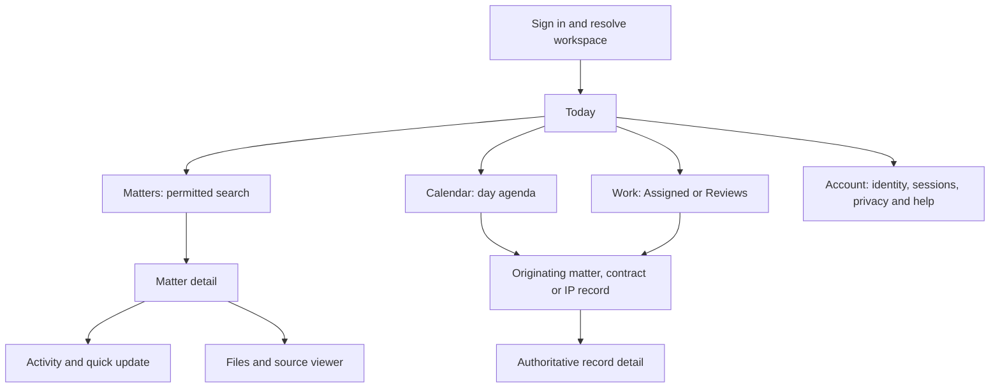

# CaseOps Android And iOS App Plan

Date: 23 October 2026. Owner: CaseOps Product and Engineering.
Status: planning only; native app implementation has not started.
Scope: an Android and iOS daily-work client for law firms, general counsel teams
and solo lawyers. This is not a replacement legal system or an app-store listing.

## 1. Decision In Brief

Build one TypeScript/React Native application with a compatible stable Expo SDK,
native development builds and platform-appropriate behavior. Reuse CaseOps'
FastAPI backend, authoritative records, permissions, source rules, budgets and
audit trail. Do not wrap the entire website in a WebView or recreate the backend.

The app's promise is narrow and practical: know what needs attention, find the
right matter, open its evidence, record the next update and return to work.
Keep critical legal acts under the existing server controls. Do not market the
app as autonomous legal advice, universal court coverage or guaranteed reminders.

Five sequential expert design reviews precede app coding. Their inputs,
critiques, concrete revisions and unresolved questions are retained in
[the iteration index](UX_ITERATIONS_2026-10-23.md). They are desk reviews, not
five participant studies, native-device tests or measured usability successes.

## 2. Current Truth And Evidence Boundary

Read-only snapshot at approximately 17:38 UTC on 23 October:

- Canonical `origin/main`: `e3b20ee648bf0d6bb20546a64b51a6afba5c2423`.
- API `/api/build`: same release; revision `caseops-api-00502-kzp`.
- Web `/api/release-identity`: same release; revision `caseops-web-00479-6xg`.
- GitHub open pull requests: zero at that observation, not a permanent state.
- Root `package.json` declares only `apps/web` as an npm workspace. The web
  client is Next.js/React/TypeScript. No native application was found in the
  inspected source. Responsive browser tests are not Android/iOS app tests.
- Existing navigation is catalog-driven in
  `apps/web/components/app/Sidebar.tsx`; the PRD's web module menu is too large
  to use unchanged as phone navigation.
- The browser API client in `apps/web/lib/api/client.ts` uses cookie-first
  sessions and CSRF. A bearer-compatible endpoint is not proof of a complete
  native login, refresh, revocation or secure-storage design.

Historical dated PRD/ledger entries still describe intermediate release failures.
Do not use those entries to claim the current E3B release is undeployed. Equally,
its web release acceptance does not certify this proposed native application.
This planning task does not redeploy the web, modify production tenants, call
paid providers or restart the superseded fresh Docker rerun.

## 3. Product Fit And Scope

### Audiences

| User | Phone job | Default presentation |
| --- | --- | --- |
| Solo advocate | Next hearing, matter search, note and document capture | My work; minimal setup; no team-administration detour |
| Associate or clerk | Assigned work, hearing update, file evidence | Assigned records with the parent and current status visible |
| Partner or practice head | Authorized team priorities and current-version review | Explicit My/Team scope; no role-title-based permission assumptions |
| General counsel or in-house team | Matter obligations, contract dates, IP renewals, review status | Obligations and deadlines are peers of hearings, not hidden behind court terminology |
| Legal ops | Calendar reliability, assignments, source/delivery state | Clear queued, unavailable, stale and completed states |

Follow the existing brand: considered, unflappable, court-ready. Reuse the logo,
bundled and licensed typography, restrained surfaces and meaningful accent colors.
No decorative dashboard, marketing hero, AI-first chat screen or new brand system.

### V1: Daily Work, Not Every Desktop Tool

| Capability | V1 boundary | Existing owner |
| --- | --- | --- |
| Login, recovery, workspace identity | Native-safe session and MFA where policy requires; no shared-device identity ambiguity | J01 / M01; J14 / M13-M14 |
| Today | Upcoming hearings, confirmed deadlines, obligations and assigned work; bounded reads | J03/J08/J10; M02/M08/M09 |
| Matters | Search permitted matters by real supported identifiers; list/detail, notes and recent work | J02/J03; M02 |
| Calendar | Complete day agenda, week navigation, filters and source freshness; no duplicate phone calendar database | J08 / M08 |
| Files | Authorized viewer; camera/file selection and existing secure upload; scan state visible | J04 / M03 |
| Quick updates | Notes and already-supported parent-scoped task/hearing commands, after exact API inventory | J03/J08 / M02/M08 |
| Work review | Existing assigned work, exact draft/recommendation evidence and genuinely neutral notes/annotations only where supported | J07/J09 / M06/M07 |
| IP and contracts | Entitled source-owned summaries/dates and originating-record navigation; no new rule calculations | J08/J10; IPLF-030/032/037 |
| Counsel and spend context | Authorized assignment/budget read-through, with exact currency/precision and no spend decision | J13 / M12 |
| Notifications | In-app inbox plus optional generic push, with reauthorization on open | J08 / M08 |
| Account | Current workspace/user, sign-out/device-session controls, privacy/help and deletion-request path | J01/J14 / M01/M14 |

`Work` is not permission to approve. Draft request-changes, approval/finalization,
recommendation decisions/execution, new paid AI generation and provider search are not v1
phone actions. Read existing outputs with their source/review limitations;
retain the web path for supported deeper work without leaking tokens in links.

### Explicitly Deferred

- Full drafting studio, long-form redlining, bulk import/cataloguration and
  portfolio spreadsheet editing.
- Disposal/reopen, broad destructive administration, entitlement changes,
  security policy edits, founder reports and report-admin user management.
- Client/outside-counsel native portals; retain the existing separate web realm.
- Private offline court packs and background/offline mutation queues.
- External document download/export/share from the native viewer; do not make
  a supposedly revocable private copy in another app or the photo library.
- Native legal research generation, new provider enrollment, automated filing,
  purchases/subscriptions or account plan changes.
- Voice transcription, contact-book upload, location access, social features,
  session replay, advertising SDKs and client-side marketing telemetry.

Later phases need new explicit scope and regression evidence. A web handoff
does not count as a natively implemented feature; show that boundary honestly.

### Current Source To Proposed Screen: Do Not Assume Missing APIs

This matrix reflects read-only code inspection, not endpoint execution. The
new client is Missing; existing primitives do not make an entire row complete.

| Proposed surface | Inspected existing owner | Current gap classification | Required work before the claim is usable |
| --- | --- | --- | --- |
| Today My/Team | `services/today_view.py:300,425`; web `lib/api/endpoints.ts:2634` | Partially implemented | Existing horizon/visible-work behavior is not a personal/team selector. Define per-stream owner/assignee, unassigned bucket, permitted team predicate, counts and continuation on the server |
| GC obligations and IP renewal triage | Existing contract/IP domain; no corresponding full Today streams found | Partially implemented | Map exact bounded source reads, authorization, responsible person, due/source fields and detail routes; no phone-side portfolio scan or new rule engine |
| Counsel/budget read-through | Existing J13/M12 assignments and spend | Partially implemented | Inventory exact permitted read contract and retain currency/precision; no new phone budgeting mutation |
| Work review | Draft route `api/routes/matters.py:3269` invokes request-changes | Partially implemented | Reading is not neutral commenting. Do not invoke that command from a Comment button; only prove real neutral annotations/notes or keep the action unavailable |
| Hearing source freshness | Today hearing shape in `services/today_view.py:85` | Partially implemented | Add/read supported provenance separately; if no source timestamp exists, show Freshness unknown or Manual date, never a fabricated check time |
| General inbox and native push | Docket-scoped `api/routes/in_app_notifications.py:21`; preference channels in `schemas/notification_preferences.py:8` | Missing | Implement bounded authorized inbox composition/device registration/FCM-APNs transport; existing preferences are not a global inbox |
| Native session and workspace switch | `api/routes/auth.py:284`; `services/identity.py:73,254`; `core/cookies.py:94` | Missing | Native handoff, rotating refresh, per-device revocation and explicit workspace transition; existing cookie logout is insufficient |
| Native upload/viewer | `services/matters.py:5688,6160`; `api/routes/matters.py:2959` | Partially implemented | Native multipart/scan/permission tests; private viewer cache policy and explicit download cache headers require review; no background/resumable support established |

Line references are against the e3b20ee6 runtime source, not new endpoint proof.
API paths in that table are relative to `apps/api/src/caseops_api/`; the web
path is relative to `apps/web/`.
Resolve each missing contract as a bounded P0/P2 integration task. Do not render
sample data as a live stream or label a missing integration an empty result.

## 4. Information Architecture

Four stable bottom destinations on phones:

1. **Today:** next work, due items and pending review, under an explicit scope.
2. **Matters:** search, recent permitted records, filters and matter detail.
3. **Calendar:** day agenda and week/date selection across existing event types.
4. **Work:** Assigned and Reviews; supported actions remain capability-gated.

No hamburger containing the entire desktop menu and no overflow More tab.
Settings and the current account are reached from a labeled header control.
The shell is stable; capabilities determine content/actions, not a reshuffling
navigation order. A restricted section explains its state without record labels.
Never expose an unentitled module merely to populate a tab.

Today means time-sensitive triage; Work means the full supported queue, including
undated work. The same item has the same source identity/status on both screens.
My/Team is a planned server contract, not an existing Today query parameter.
If that contract is not implemented, label the actual scope Visible work and
do not claim a My/Team feature. A labeled notification icon in Today opens the
future bounded inbox only after its read model exists. Read/dismiss does not
complete the underlying work. Search is labeled by its actual record domain.

Matter detail has Summary, Activity, Files and Work as its local hierarchy.
Do not add a second persistent bottom bar. Keep the matter code/title/status
visible during a command. IP dockets and contracts retain their actual types;
do not rename or manufacture a Matter identity for them. Their list/detail entry
from Today/Calendar and an entitled record-type filter must be implemented using
actual existing server-owned read contracts, not assumed to be a unified search.



### Critical Flows

**First use:** open app -> enter workspace or use its verified invitation ->
authenticate in a secure system authentication session -> satisfy current MFA
policy -> complete native handoff -> confirm workspace -> Today. Password reset
and expired/revoked invitation recovery must return to the correct authenticated
realm. A Calendar-provider Google consent is not CaseOps sign-in.
There is no proven native authenticated workspace-switch API. Until one passes
its contract/security gates, switching workspace means explicit logout and new
login; purge all prior private state before accepting the new context.

**Before a hearing:** Today -> hearing -> current matter -> sources/hearing pack
already available -> source/version check -> read. Show missing or stale pack
honestly; do not silently invoke paid generation or claim downloaded offline access.
The online viewer must support page navigation, source opening and returning
to the same place. App foreground/resume revalidates access before restoring
private content. Last loaded is not Source checked; display unknown/manual
freshness explicitly when source data is absent.

**After a hearing:** named matter -> supported update -> date/status validation ->
save once -> authoritative acknowledgement -> activity reload. A hearing update
never activates, disposes or reopens its parent.

**Capture a file:** choose authorized parent -> select camera/file explicitly ->
review selection -> upload -> scanner result -> persisted attachment. Permission
denial offers a file-picker alternative. Do not save camera originals to the
photo library automatically. Bounded app-private temporary data is removed on
completion/cancel; interrupted cleanup must run on next startup.

**GC review:** Today obligation -> originating contract -> source date and
responsible person -> authorized work item/review evidence -> supported update.
Do not imply a source contract obligation is a newly calculated legal deadline.

**Push open:** generic notification -> authenticate/unlock -> recheck workspace,
permission and source identity -> authorized destination or safe unavailable state.
Never automatically switch into another account and display its record.

## 5. Interaction And Screen Contracts

| Surface | Always visible | Failure/recovery requirement |
| --- | --- | --- |
| Today | Date, workspace, My/Team scope, next actionable records | Distinguish no assigned work from read failure; show source freshness |
| Search/list | Search term, record type/filter, identifying code and bounded continuation | Permission change cannot leave stale result labels; no corpus-scale browser scan |
| Record detail | Type, title/code, lifecycle, next date and source/review state | Terminal records stay read-only; no generic status toggle |
| Update editor | Parent, actual required fields, explicit Save/Cancel | Keep authorized foreground input on field error; no automatic resubmit |
| Calendar | Date, timezone where relevant, event type and full agenda | Overflow always reachable; date-only dates never shift with timezone conversion |
| Viewer | Source/version and page controls | Reject unavailable/unscanned/revoked bytes; source opening uses audited server routes |
| Work review | Exact current version, sources and review state | Missing validation is not positive validation; no formal approve in v1 |
| Account | Signed-in person and workspace, current session controls | Logout/tenant switch clears private memory and temp files; preserve realm separation |

Targets are at least 44 pt on iOS and 48 dp on Android, with non-overlapping hit
areas. Large text up to 200%, long names, keyboard, safe areas and both back
models must work. Calendar uses agenda rows rather than unreadable event chips.
Use visible labels, screen-reader names, status text and familiar iconography.
Respect reduced motion. Keep fixed accessible type scales, not viewport-scaled
fonts. Test normal text contrast at least 4.5:1 and large text at least 3:1.

### Revision 5 Wireframes

Planning wireframes only; Example Legal and all records are fictional. They do
not establish implemented endpoints, pixel layout or a source verification.

```text
TODAY                              MATTER DETAIL
+--------------------------------+ +--------------------------------+
| Example Legal         Account  | | Back     MAT-104       Account |
| Today            Notifications | | Sample matter                  |
| Visible work      Fri 23 Oct   | | Active   Example Legal         |
| Search matters                 | |--------------------------------|
|--------------------------------| | Summary  Activity  Files  Work |
| Next                           | |                                |
| 10:30  Hearing   MAT-104        | | Next hearing: 23 Oct, 10:30     |
| Sample matter                  | | Freshness: unknown             |
| Freshness: unknown             | | Source details                 |
|                                | |                                |
| Due today                      | | Recent activity                |
| Obligation        Contract C12 | | Note saved: [server timestamp] |
| Open source contract           | |                                |
|--------------------------------| | Add note                       |
| Today  Matters  Calendar  Work  | | Today  Matters  Calendar  Work |
+--------------------------------+ +--------------------------------+

SAVE NOTE: FULL-SCREEN EDITOR       CALENDAR: COMPLETE DAY AGENDA
+--------------------------------+ +--------------------------------+
| Cancel              Save note  | | Example Legal         Account  |
| MAT-104  Sample matter         | | Calendar                       |
|--------------------------------| | Previous   23 Oct   Next       |
| Note                           | | All event types                |
| [Editable text area]           | |--------------------------------|
|                                | | 10:30 Hearing       MAT-104    |
| Parent remains visible         | | 14:00 Deadline      Docket P8  |
| Error appears beside its field | | 16:30 Obligation    Contract C12|
|                                | | More results: explicit paging  |
| [Keyboard-safe actions]        | | Today  Matters  Calendar  Work |
+--------------------------------+ +--------------------------------+
```

Visible work deliberately depicts the existing scope fallback; My/Team can
replace it only after the new server contract passes. The Notifications entry
and GC streams appear only once their missing integrations pass. All event and
record types retain their own authoritative identifiers and permissions.

English-first follows the current product. Support Unicode names, local number
formatting and explicit timezones; do not claim a translated legal document or
Hindi/regional-language workflow without its separate reviewed scope. Global
distribution does not expand India-specific court/provider/legal capabilities.

## 6. Technical Choice And Alternatives

| Option | Fit for CaseOps | Decision |
| --- | --- | --- |
| React Native + stable Expo development builds | Reuses React/TypeScript skills and typed API contracts while permitting real native controls | Recommended, subject to a two-platform dependency/auth spike |
| Separate Swift and Kotlin apps | Strong platform control, but duplicates UI/workflow implementation and review | Reconsider only if a proven native requirement blocks the shared client |
| Flutter | Credible native UI option, but introduces Dart and cannot reuse the existing TS contract layer directly | Not preferred for this codebase |
| PWA or whole-site WebView | Lowest initial UI reuse cost but does not establish the desired native experience | Keep responsive web available; not the proposed store app |

Proposed ownership, not an instruction to create these packages now:

```text
apps/mobile/                 Native screens, routing, device integrations
packages/api-contracts/       Bounded generated DTOs and pure shared validation
tests/mobile/                Native Appium scenarios and evidence inventory
apps/api/                    Existing authoritative business/security services
apps/web/                    Existing browser client, still independently tested
```

Share pure contracts only where justified. DOM components, browser session code,
Next.js routing and CSS do not become native components. Avoid a broad web
refactor or a speculative shared design framework. Pin a compatible stable
Expo/React Native/React/native-module set after the P0 build proof; verify licenses,
SBOM and advisories. Do not copy the web React version into a native dependency
graph without checking its SDK compatibility.

### Native Authentication Is A P0 Gap, Not A Cookie Workaround

Preferred design: system authentication session using existing CaseOps credential
and MFA policies, followed by a server-issued short-lived, single-use native
handoff bound to PKCE, state, intended client, workspace and redirect allowlist.
This is proposed new backend work, not an existing OAuth authorization server.
Keep browser HttpOnly/CSRF controls unchanged. Do not scrape browser cookies or
put long-lived credentials into redirect URLs. Prove expiry, replay, cancellation,
wrong-device, wrong-tenant and concurrent login behavior before feature coding.
Current cookie precedence must not cause a native bearer request to act as a
different browser user. Require a deliberately isolated native credential
contract and reject ambiguous/mixed authority; do not weaken browser CSRF.
Current step-up proof is user/membership-scoped, not demonstrated device-session
binding. Establish the required native session/audience binding in P0.

Use short-lived access credentials in memory and an explicitly revocable,
rotating native refresh/session credential in OS secure storage. Prove server
logout, revocation, reuse handling and MFA/session version enforcement; do not
assume existing bearer compatibility proves those properties. Never persist
passwords, legal documents or MFA secrets in AsyncStorage. Local biometric
unlock does not replace server MFA. Test biometric enrollment changes, secure
store errors and iOS Keychain state that can survive reinstall.

Verified HTTPS App Links/Universal Links should be the production routing path.
Association files need actual signed application identifiers; these are not yet
provisioned. Never trust a record ID, tenant slug or return URL solely because
it arrived from a link. Strictly separate tenant, portal and platform-admin realms.

### Data, Upload And Push

- Query caches are memory-only, keyed by principal, workspace and realm, bounded
  and discarded on switch/logout/revocation. Reauthorize sensitive actions.
- V1 has no persistent private offline cache. Backgrounding hides sensitive
  app-switcher previews; session locking follows reviewed tenant policy.
  Android capture restriction and iOS capture detection/redaction need device
  verification; do not promise universal screenshot prevention on iOS.
- Uploads retain the existing scanner fence. Choose bounded file limits and
  cancellation behavior from actual server contracts. Do not bypass scanning,
  turn image capture into an automatic OCR claim or retain originals by default.
- Extend the existing durable notification owner with registered device endpoints
  and bounded delivery attempts. Prefer direct FCM for Android and APNs for iOS
  from the existing GCP backend, subject to a small transport spike. Expo's push
  relay is an alternative only after its data-processing/retention review; it
  is not an implicitly approved new processor.
- APNs credentials/Apple entitlements are still needed; a Google Cloud account
  alone does not provide an iOS signing identity or push authorization.
- Push payloads are generic and reference-only. Token rotation, revocation,
  logout, channel settings, receipts and undeliverable tokens need explicit
  retention/cleanup. Provider acceptance is not delivery or user acknowledgement.
- No new paid AI path. Later generation must reuse the owner's current shared
  INR 10,000/month policy and existing source/access controls. Never introduce
  an uncapped fallback through the mobile app.

## 7. Five-Round Review And Validation Boundary

The review artifacts are sequential, not five independent opinions relabeled
as iterations. Each consumes the prior decisions and carries unresolved risks
forward. The final design remains a hypothesis until participant and native tests.
See [the review record](UX_ITERATIONS_2026-10-23.md).

After these desk rounds, a design-only clickable prototype should test at least
two solo advocates, two firm users including a reviewer, and two GC/legal-ops
users. This is a planned recruitment target, not completed research. Use fake
records, consent and no live provider calls. Do not make human testing a
substitute for automated regression. A real cohort can change the design; a
critical usability finding must be fixed before release.

Target tasks: find the next work item and its source, search a known matter,
save a note, capture a file, find every event on a busy day, navigate a GC
obligation and recognize a blocked/stale/unknown operation without unsafe retry.
Targets, not observed results: at least 90% unassisted task completion, median
find-next-item <=15 seconds and note-save <=45 seconds excluding network delay,
zero wrong-parent saves, zero mistaken lifecycle changes and zero confusion
between queued and delivered. Record raw outcomes and disagreements; small
cohorts are formative evidence, not population-level adoption proof.

## 8. Build Order And Milestone Gates

Do not equate a skeleton compiling with a completed app. Android and iOS move
through the same gates; one platform's pass does not certify the other.

| Gate | Work | Exit evidence | Indicative effort, not a delivery promise |
| --- | --- | --- | --- |
| P0: feasibility and contract readiness | Stable SDK pair; auth/session proof; signing/links; endpoint and device inventory; privacy/store policy assessment | Both native builds install; login/MFA/refresh/revoke tested against isolated backend; dependencies and critical gaps resolved | 2-4 working days once access exists |
| P1: design prototype | Convert the five-round specification into clickable Android/iOS flows; conduct task trials and fix critical findings | Recorded flows, accessible layouts, unresolved findings list and scope lock | 2-4 working days plus participant availability |
| P2: first vertical slice | Native session -> Today -> matter -> note -> persisted reload, with stale-write/terminal negatives | Appium Android+iOS receipts and exact Docker backend source identity | 5-8 working days |
| P3: remaining v1 | Complete agenda, native viewer/capture, Work, IP/contract entry points, generic push, privacy/session controls | Complete intended native inventory, security/scan tests and real-device behavior | 4-7 working days |
| P4: beta and release | Signed Google Play internal testing and TestFlight builds; regression, store materials and owner acceptance | All critical cases passed on both platforms; compatible deployed API; reviewed store submissions | 3-5 working days plus external review time |

Planning range: 16-28 working days of sequential work at the stated scope,
with overlap possible for a staffed team. Staffing, existing auth gaps, device
access and store review can move this range. Re-estimate after P0 rather than
promise a launch date before native access is established.

First app coding begins only after the five documented desk rounds. Start with
the P0 feasibility spike and P1 design prototype, not all modules at once.
Do not build features on an unproved native-session shortcut. No app code,
package installation, signing, paid cloud build or store submission occurs in
this planning task.

## 9. Quality, Security And Release

The [acceptance matrix](MOBILE_ACCEPTANCE_MATRIX_2026-10-23.md) is a planned
inventory, not passing evidence. It binds scenarios to PRD journeys and required
environments. Add actual discovered native identities and structured per-case
results when executable tests exist. Zero tests collected is incomplete, not green.

- Preserve full existing API, PostgreSQL, frontend and Playwright regression
  where shared source changes. Run the canonical full local Docker gate before
  a combined backend release; do not replace it with a selected mobile subset.
- Use Appium with UiAutomator2 on Android and XCUITest on iOS for actual native
  E2E. Playwright verifies browser compatibility and web handoff, not a native
  view, biometric prompt, OS link or push behavior.
- Windows supports the local Android/backend workflow. iOS compilation,
  Simulator and XCUITest require an appropriate macOS/Xcode environment; Docker
  on this workstation cannot substitute for it. Approved cloud build services
  can produce binaries but do not alone prove iPhone interaction tests.
- Use isolated Docker PostgreSQL, deterministic provider emulators and dedicated
  QA accounts. Every automated application request carries the existing
  no-paid-provider marker. No real client data, synthetic production leads or
  billable provider probes. No GBA writes or entitlement rewrites.
- Run physical Android and iPhone checks for camera, file picker, biometrics,
  permission denial, app background/kill/restart, push and verified links.
- Select the supported OS floor after SDK and actual device review. Cover that
  minimum, a current OS, small/large phones, tablet layout, low-memory Android,
  large text and network loss. Do not invent a tested OS/device matrix now.
- Apply OWASP MASVS storage/auth/network/platform/privacy checks and secure
  dependency/license gates. Keep security logs free of tokens and legal content.
- Measure candidate targets on named devices: cold app shell <=3 seconds,
  next-work usable <=5 seconds on the agreed test network, already-loaded tab
  switch <=300 ms, zero navigation-triggered duplicate supporting reads. These
  are proposed acceptance budgets, not production measurements or a timeout waiver.
- Bind app version/build number, source SHA, API compatibility and signed binary
  hash to release evidence. Test current and previous supported app clients
  through a backend rollout; use additive contracts and independent rollback.
- Keep native signing and release channels separate from web deploy. Protected
  main/CI, exact-SHA backend release and native staged rollout are all required
  where relevant. Store approval is external, never guaranteed.
- Do not enable automatic over-the-air feature changes by default. If adopted,
  review signing, runtime compatibility, rollout/rollback and store rules first.
- Crash reporting requires an approved, minimized, redacted telemetry decision;
  no session replay, legal text, record URLs or advertising identifiers. Keep
  marketing GA4 and client-side attribution disabled.

## 10. Owner Dependencies And Cost Boundaries

Can proceed without production changes: specification, fake-data prototype,
API contract review, threat model and local Android feasibility preparation.

Required before signed distribution:

1. Confirm the company-owned Apple Developer/App Store Connect and Google Play
   Console organizations, authorized signing roles and public app ownership.
2. Provide a managed Mac/macOS CI path and an authorized iPhone, plus Android
   devices. Do not upload customer data or signing keys to an unapproved service.
3. Approve bundle/package identifiers after availability checks; proposed values
   must not be treated as registered identifiers.
4. Review mobile privacy/support/deletion/retention notices, permission purposes,
   processing vendors and test-reviewer access with fake data.
5. Classify enterprise/solo subscriptions against current store payment rules.
   V1 has no checkout; do not assume that omission alone creates an exemption.
6. Approve any developer memberships, macOS/cloud/device testing or build spend
   separately. The AI monthly budget is not an app-development/cloud budget.

No new external account, billing commitment, broad OAuth grant or production
provider activation is authorized merely by this plan. Existing owner-pending
MFA, Ram's old external Calendar cleanup, legal-source reviews and provider
consent gaps remain open and are not mobile workarounds.

## 11. Primary References

Official guidance checked on 23 October 2026; recheck at the implementation and
submission gates because SDK and store requirements change.

- [Expo development builds](https://docs.expo.dev/develop/development-builds/introduction/): use native development builds, not Expo Go as release proof.
- [Expo authentication](https://docs.expo.dev/guides/authentication/): native redirects and provider-secret boundaries; this does not give CaseOps an authorization server.
- [Expo SecureStore](https://docs.expo.dev/versions/latest/sdk/securestore/): OS-backed secret storage and platform lifecycle caveats.
- [Expo push overview](https://docs.expo.dev/push-notifications/overview/): push transport choices; relay use is not automatically approved.
- [Apple tab bars](https://developer.apple.com/design/human-interface-guidelines/tab-bars): stable labeled navigation and avoiding overflow destinations.
- [Apple interface guidance](https://developer.apple.com/design/tips/): touch targets and legible interaction.
- [Android accessibility](https://developer.android.com/guide/topics/ui/accessibility/views/apps-views): accessible targets and controls.
- [Android App Links](https://developer.android.com/training/app-links): verified website association rather than trusting arbitrary links.
- [Firebase Cloud Messaging](https://firebase.google.com/docs/cloud-messaging): existing-GCP transport option; application integration is still required.
- [Apple App Review Guidelines](https://developer.apple.com/app-store/review/guidelines/): native utility, account, login, privacy and purchase review. This plan is not legal compliance certification.
- [Apple deletion guidance](https://developer.apple.com/help/app-review/guideline-reference/5-1-1-account-deletion/) and [Google Play deletion requirements](https://support.google.com/googleplay/android-developer/answer/13327111): policy assessment and deletion-request design.
- [Google Play target API policy](https://support.google.com/googleplay/android-developer/answer/16561298): choose current compliant targets at submission, not a stale hard-coded value.
- [Appium](https://appium.io/docs/en/latest/quickstart/) and [XCUITest requirements](https://appium.github.io/appium-xcuitest-driver/latest/installation/requirements/): native E2E infrastructure, separate from browser testing.
- [OWASP MASVS](https://mas.owasp.org/MASVS/): mobile storage, authorization, network and privacy verification categories.

## 12. Completion Definition

Planning completion means an explicit scope, five traceable design rounds,
architecture decisions, unresolved dependencies and an executable acceptance
plan. It does not mean the app is built, tested, published or deployed.
Native release readiness remains **NO-GO** until implementation and both-platform
evidence exist. No app-user task or native test is marked passed by this document.
