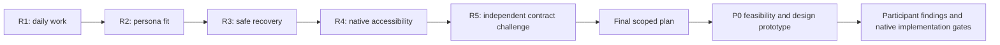

# Five Sequential Mobile UI/UX Iterations

Date: 23 October 2026. Baseline source: e3b20ee6.
Status: five expert desk-review rounds completed; no app implementation started.
These are documented reasoning/wireframe iterations, not five user studies or
native-device acceptance. All future usability metrics remain unmeasured.

| Round | Input | Critique | Concrete revision | Retained artifact |
| --- | --- | --- | --- | --- |
| 1: daily work | Desktop dashboard/module menu | Too many module choices before a daily task | Four stable destinations and Today-first task navigation | [R01](iterations/R01_DAILY_WORK_FIRST.md) |
| 2: persona/context | Revision 1 | Hearing bias excludes GC; repeated parent selection risks wrong record | Obligations/IP as source-owned work, visible scope and context-first capture | [R02](iterations/R02_PERSONA_AND_CONTEXT.md) |
| 3: trust/recovery | Revision 2 | Stale/failed/unknown states can look like success or no hearing | Online-first boundary, explicit state model, save-once and no lifecycle shortcuts | [R03](iterations/R03_TRUST_AND_RECOVERY.md) |
| 4: native/accessibility | Revision 3 | Small targets, keyboard, same-phone MFA and dense calendar remain difficult | Agenda, full-screen editing, target sizes, text scaling and native back behavior | [R04](iterations/R04_NATIVE_AND_ACCESSIBLE.md) |
| 5: independent challenge | Revisions 1-4 plus source audit | My/Team, GC streams, comment semantics, inbox, freshness and native auth were assumed | Explicit missing-contract map, neutral-review boundary, honest source and identity behavior | [R05](iterations/R05_SCOPE_AND_ADVERSARIAL_REVIEW.md) |

Round 5 supersedes assumptions retained in older rounds; do not cherry-pick
R02's proposed scope switch or R04's illustrative source timestamp as an
implemented feature. Keeping earlier revisions is intentional traceability.

The resulting [app plan](MOBILE_APP_PLAN_2026-10-23.md) and
[acceptance matrix](MOBILE_ACCEPTANCE_MATRIX_2026-10-23.md) define the next work.
Human trials and actual native automated tests can reveal further changes;
five review rounds are not a guarantee that no usability problem remains.
