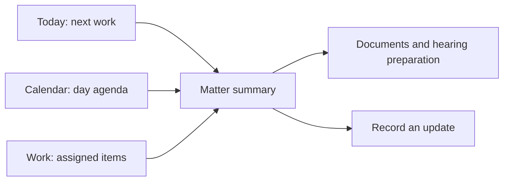

# Round 1: Daily Work Before Module Navigation

Date: 23 October 2026. Method: expert desk review, not participant testing.
Input: serving-source e3b20ee6, `.impeccable.md`, PRD personas P1-P7 and
journeys J01/J03/J04/J08/J10/J12. No app implementation exists.

## Starting Concept

Shrink the web sidebar into a hamburger menu; open on dashboard statistics;
retain all module names, tables and desktop actions.

## Critique

- Hearing preparation starts with choosing a module instead of the next job.
- A solo advocate must scan the same administrative choices as legal ops.
- Dense tables and hover actions do not become usable simply by fitting them.
- A firm-wide statistic can be mistaken for the user's assigned workload.
- A prominent AI prompt competes with the authoritative matter and dates.

## Revision 1

Adopt four stable destinations: Today, Matters, Calendar, Work. Keep workspace
and signed-in identity visible in the header; settings open from the account
control, not from a fifth overflow tab. Use labeled platform navigation icons.
Search lives in Matters; a scoped search action is reachable from Today.

Today is a chronological operational list, not a wall of metrics. Its first
screen shows the next hearing/deadline, assigned work and an explicit scope.
An empty hearing list must not imply that obligations or IP deadlines are empty.

## Walkthrough Result

Desk tracing exposes the next matter directly from Today without opening the
module menu. Finding an arbitrary matter uses Matters search. GC work remains
underrepresented because a hearing-heavy Today could hide contract obligations.
That is carried forward, not declared solved.

## Carry Forward

Round 2 must test solo, associate, partner and GC task paths and define how one
navigation model supports their different work without granting different access.
No measured completion times, satisfaction score or usability pass is claimed.
