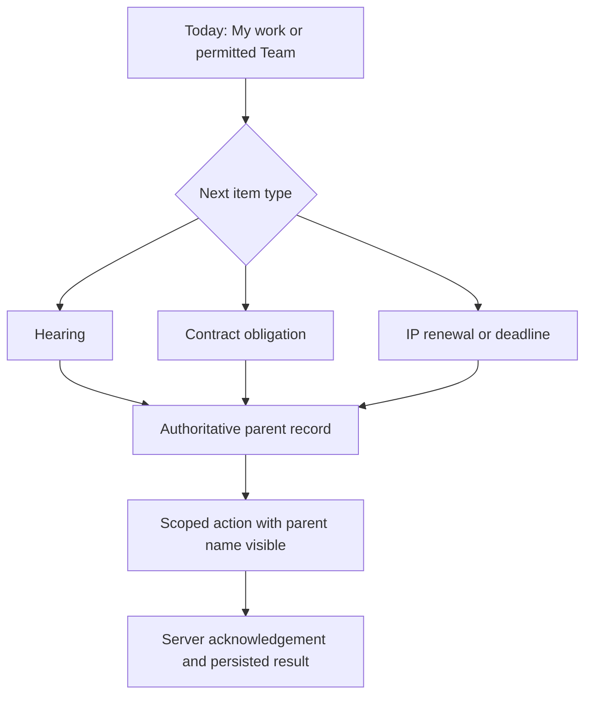

# Round 2: Persona Fit and Context Preservation

Date: 23 October 2026. Method: sequential expert walkthrough of Revision 1.
Input: Round 1's four destinations and unresolved GC/hearing bias.

## Critique Of Revision 1

- A GC's urgent contract obligation is as important as an advocate's hearing.
- A partner needs an authorized team view; a junior normally needs assigned work.
- Requiring a matter choice after the lawyer has already opened a matter wastes
  input and risks saving an update against the wrong record.
- A universal add button creates a large menu and hides the required parent.
- Separate phone-only copies of IP dates or tasks would diverge from the web.

## Revision 2

Keep the four navigation destinations stable. Today interleaves upcoming
hearings, confirmed deadlines, contract obligations and IP renewal work through
their existing server-owned records. Do not build a new legal deadline engine.
Default to My work; allow Team only with current server permission. Show the
selected scope beside the date. Display source freshness independently of due
date. Do not call an aggregated portfolio total a personal task count.

Work has two labeled segments: Assigned and Reviews. Neither is an automatic
grant of approval authority. Source links return to the originating record.
Inside a matter, show Summary, Activity, Files and Work. Secondary tools are
contextual actions, not another persistent bottom-navigation bar.

Start quick capture from a named matter whenever possible. Outside a matter,
choose an authorized parent first, then the supported update type. V1 emphasizes
notes, existing task actions, hearing updates where supported, and file capture.
Do not invent missing generic-task or hearing APIs to satisfy a mockup.

## Walkthrough Result

Solo: hearing -> matter -> note has no team or client-management setup detour.
Associate: an assigned item retains its parent into capture.
Partner: team review is explicit rather than inferred from a job title.
GC: obligations and renewals remain reachable without a court-first workflow.
These are desk-traced paths, not measured user outcomes or API completeness proof.

## Carry Forward

Revision 2 still assumes a healthy network and current authorization. Round 3
must prevent stale dates, terminal-record writes and ambiguous transport results
from becoming misleading success, duplicate actions or accidental reopening.
