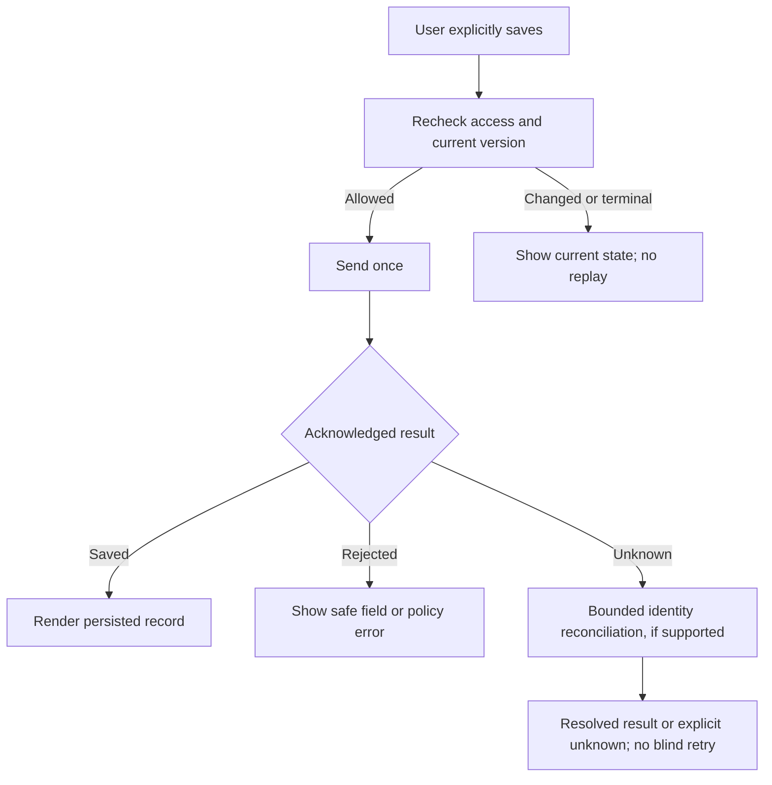

# Round 3: Trust, Connectivity and Safe Recovery

Date: 23 October 2026. Method: failure-state walkthrough of Revision 2.
Input: Round 2's persona paths, existing lifecycle/source/provider constraints.

## Critique Of Revision 2

- A cached hearing date can look current after a provider outage.
- A success toast before server acknowledgement can lose a note or upload.
- Retrying a timed-out mutation can create a duplicate or replay a stale command.
- A terminal matter or revoked grant can change while the screen is open.
- A push preview can expose a client name on a locked or shared phone.
- Offline confidential downloads cannot honestly promise immediate remote recall.

## Revision 3

- V1 is online-first. Do not persist private matter responses, notes, drafts or
  document bytes for offline use. Show disconnected state without blank-success
  screens. Unsaved text is foreground memory only; app termination can lose it.
  Explain this limitation before relying on it, and warn on ordinary navigation.
- Distinguish Loading, Current, Stale, Unavailable, Not permitted and Empty.
  Show last successful source refresh, not the last time the screen rendered.
  Keep date-only legal dates separate from timezone-aware appointment instants.
- Refresh current permissions, parent version and lifecycle before a command.
  On conflict, show authoritative state and preserve the user's text in the
  current authorized foreground session; do not replay the mutation.
- If a command outcome is unknown, reconcile that operation's identity where
  supported. Otherwise stop with an honest unknown outcome. Disable duplicate
  submit; no automatic mutation transport retry.
- Terminal matters remain explicitly labeled and read-only for ordinary
  operations. Dispose/reopen and broad destructive commands stay web-only in v1.
- A push contains generic copy and an opaque reference only. On open, authenticate
  and reauthorize before resolving the destination. Permission denial does not
  block Today or the in-app inbox. No notification is a guaranteed legal alert.
- File capture shows Selected -> Uploading -> Security scan -> Available or
  Rejected. Keep an unknown result separate; never present unscanned bytes as
  an available legal record. Use the existing server upload and audit owner.

## Walkthrough Result

The design no longer treats failed refresh as no hearing, permission loss as an
empty portfolio, or an optimistic toast as durable save. It explicitly declines
offline private court packs in v1. This reduces capability, not the security
boundary. Implementation and native race tests are still required.

## Carry Forward

Round 4 must make the safe states understandable and operable with one hand,
large text, a screen reader, the software keyboard and both platforms' back
navigation. No code or native test has run.
