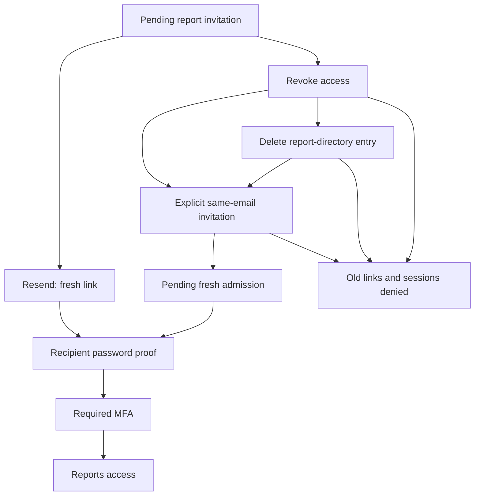

# Administrator Invitation Recovery

## Status And Incident

Local implementation is present; browser and release acceptance are pending.
J14/M14/US-040/042 and
FT-060/061 extend the existing PRA-04/07 authentication boundary. The owner
clarified that the recipients did not open their invitations: their pending
report grants were revoked, and inviting the same email then returned a conflict.
Do not describe this incident as a proven broken delivered link.

The serving92f162b4 and leads081e005b invitation implementation is identical:
revoked grants are rejected, the directory offers Invite/Revoke only, and the
existing public self-service resend is limited to pending grants with a durable
five-minute cooldown. The current leads release remains a separate work stream.

## Required Contract

- PRA-10: provide a manager-directory Resend invitation command for an eligible
  pending viewer. Create a new one-use link, invalidate its predecessor, retain
  the cooldown and report the actual accepted/failed/unknown transport state.
  An uncertain result is never an automatic retry or proof of inbox delivery.
- PRA-11: allow the current authorized issuer to invite a revoked viewer with
  the same email/name. Reuse the existing shared User and preserve its password,
  tenant memberships and business data. Preserve first-password initialization
  for a never-accepted invitation; an established User still proves its existing
  password. Fresh admission starts pending and still requires MFA before reports.
- PRA-12: offer confirmed deletion of report-administrator access. This removes
  the entry from the operational directory, not the person's CaseOps account,
  audit history or tenant data. The authorized issuer can subsequently invite
  that email again; obsolete links and sessions remain unusable.
- PRA-13: show the current account name alongside its stable ID in Usage,
  Revenue, Profit and Account profitability rows and in account-specific
  Overview alerts. Activity already has account names. Provider-cost warnings
  remain provider warnings without a fabricated account. The server resolves
  only the selected page's or bounded alert set's Company identities; no extra
  browser lookup is required. Names are current account labels, not a historical
  invoice-identity snapshot. Missing labels say **Account name not recorded**.

Named report responses use `include_account_names=true`; legacy requests retain
their exact strict DTO shapes and financial values. The separate administrator
management read similarly carries command versions without widening old records.

Every command requires live manager authority, its own root/issuer scope, CSRF
and fresh MFA. Managers, self and founder authority are not removable viewer
targets. A globally disabled User cannot be re-enabled through this workflow.
Concurrent or stale commands must not affect a later admission silently.

## Planned Operator Flow

These steps are a candidate guide, not a claim that the controls are live yet.

1. Open `https://caseops.ai/platform/admins` using the report-manager account.
2. For an eligible pending invitation choose **Resend invitation**. Use only
   the newest email; a replaced, expired, revoked or used link cannot join.
3. To restore a revoked invitation, invite the same email/name again. This is
   an explicit new admission, not restoration of its previous session.
4. To remove report access from the directory, choose **Delete**, review the
   target and confirm the reason. No tenant account or business record is erased.
5. A later invitation can use the same email. The recipient completes password
   proof and MFA; an email-provider acknowledgement alone is not successful join.

## Acceptance Inventory

The first complete combined browser CI retained613 passed,17 explicitly skipped,
two renderer failures and two real-journey timeouts. Both real Leads journeys
passed separately. The renderer expected50 rows while the real bounded client
requests25. Both real journeys stopped reading the fresh resend409 through the
browser response-body helper, before the local invitation-aging hook executed;
the UI already displayed the rejection. The candidate correction preserves the
full problem DTO in an explicit API known-denial probe and separately asserts
the real browser status, request version, actionable copy and unchanged mail/
epoch. It does not change production code, security, cooldowns or timeouts.
Complete fresh browser/Docker/CI and production acceptance remain pending.

The first combined CI and an unchanged local replay both rejected the new
management route because its real HTTP tests composed the path from a prefix,
which the route inventory could not discover. Preserve that failed evidence.
The replacement uses the canonical path in the existing positive contract and
adds anonymous and MFA-verified viewer denial tests. The route-inventory,
OpenAPI, role-guard and recovery modules must complete together before another
full Docker run. This correction does not weaken the inventory gate or prove
deployment, owner sign-in or email delivery.

Retain an actual failing regression for pending -> revoke -> same-email invite.
Prove new and established accounts, reused identity, immutable old audits,
fresh invitation and obsolete-link rejection, repeated admission/replay,
removal/directory reload/re-add, self/manager/other-issuer/root denial, inactive
User rejection, CSRF/fresh-MFA checks, bounded cooldown and delivery uncertainty.
Use isolated PostgreSQL races for competing commands and acceptance/revocation;
do not treat SQLite writer serialization as concurrency proof.

The real local browser journey must use the existing loopback-only mail adapter,
the canonical no-paid marker and a newly built runtime. Follow the captured link,
complete password and MFA, assert revoked/removed-session denial, and reload the
directory at desktop and narrow mobile widths. Reconcile the actual standard
collection, every changed helper consumer and all setup/call/teardown phases.

Production checks must prove exact API/web identities and distinguish actual
read-only owner access from synthetic renderer contracts. Never send an automated
production invitation, enroll another person's factor, expose a raw setup link,
or remove a real administrator as a test fixture. Required human dependencies
and unverified delivery outcomes remain explicit.

## Provisional Local Checkpoint

The full frontend replacement passed1835 tests in241 files with zero skipped
cases and unchanged coverage thresholds. Earlier failed/incomplete results are
retained. Canonical OpenAPI generation and the normal route typecheck passed.
The nine-module native selection passed318 identities/954 phases; its outer
PostgreSQL source guard still failed on a separately owned unselected emulator
test edit. Runtime/selected-input equivalence is a qualified component finding,
not a whole-tree gate. A stable four-case PostgreSQL supplement proves the
native single-active-root/manager fences and both existing/new-user first-
invitation races. Full Docker, hosted/current-main CI and exact-serving browser
verification remain pending. The enquiry and this recovery/name change will
ship in one combined release, not an intermediate Leads-only deployment.
