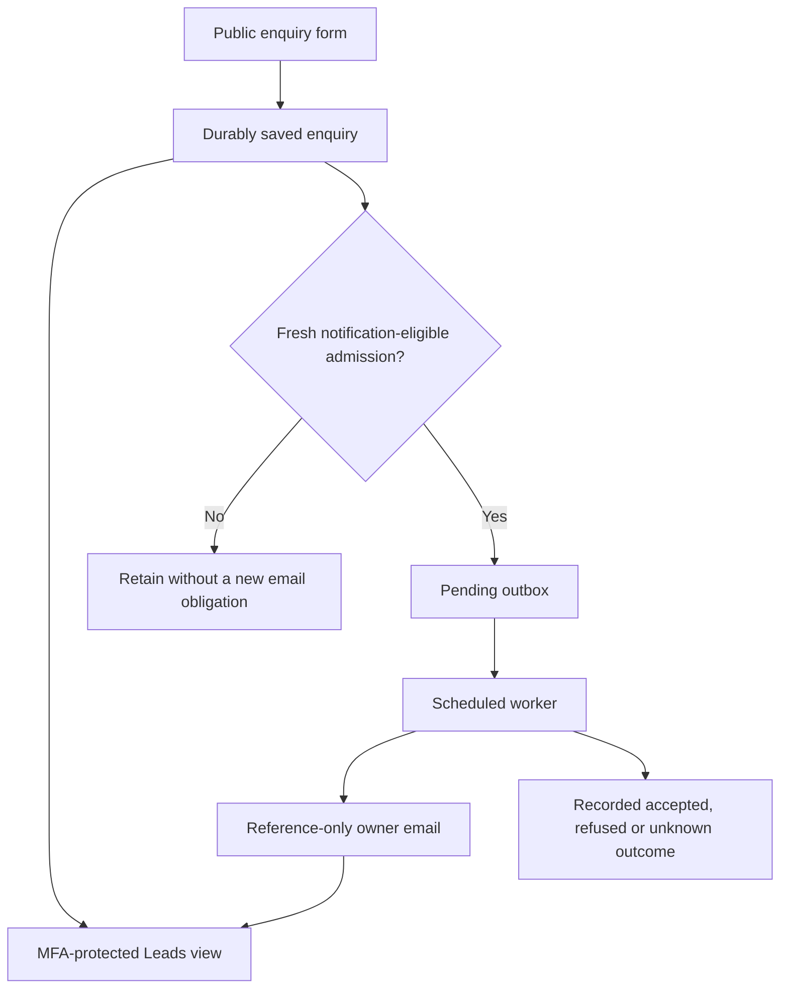

# Public Enquiries And Isolated Leads

## Scope And Status

Implemented on the candidate branch; release acceptance is pending. This extends
the existing durable public demo admission, not a new CRM or a repair of missing
admission. The worker-only correction, complete release gates and exact-serving
verification remain required. No synthetic production lead, test provider send,
retention activation or historical mail replay is authorized by this document.

PRD mapping: public admission J19/M21/US-063, FT-094..096, NFT-023 and SEC-031;
isolated administration J14/M14/US-040/042, FT-060/061. The seven public entry
routes already share DemoRequestForm and the durable enrollment/outbox flow:
home CTA, pricing, solo lawyers, law firms, general counsels, guide and resource.
Passwords, setup/reset links, MFA and private workspace forms are excluded.

## Application Contract

- LEAD-01: retain all proven public enquiries in the existing enrollment table.
  A bounded classification/index supports read pagination. Backfill recognizes
  demo-request status, known admission contracts and the pre-contract server UTC
  demo_requested_at marker, including later converted enquiries. Source names
  alone do not establish public admission. Migration changes classification only,
  never notification state or eligibility. Downgrade refuses before any schema
  or data change; rollback uses roll-forward or a verified pre-release restore.
- LEAD-02: GET /api/platform-console/leads uses the existing console cookie,
  live grant and completed MFA with manager authority. Tenant Bearer credentials,
  report viewers, anonymous/challenged sessions and stale/revoked grants do not
  gain access. The read audit carries a report identifier, not submitted PII.
  Existing founder billing authority is not delegated.
- LEAD-03: /platform/leads renders the allowlisted submitted name, email, phone,
  firm/company, segment, selected plan, public entry point, role, intent, notes,
  notice version and server submission time. Signed keyset pages default to25,
  maximum100, ordered by server created_at and stable ID. There is no250-row
  truncation, unbounded count, bulk export, qualification score or CRM mutation.
- LEAD-04: only fresh admissions under the enabled owner policy receive
  notification_purpose public_lead_20261021, notification_policy
  owner_public_enquiries_v1 and notification_eligible true. These server-written
  fields are persisted before acknowledgement. Old-key replay returns the
  original result without altering its snapshot. Missing markers, legacy rows
  and admissions made while the purpose is disabled stay ineligible forever.
  Deployment and restart do not compute a date or retrofit a cohort. The server
  created_at and notification_admitted_at record admission time; no client date
  controls eligibility. A pause retains already-eligible obligations separately
  from transport readiness. Missing sender configuration does not make a new
  eligible lead disappear; it remains in the bounded outbox.
- LEAD-05: the existing reminders worker drains only public-classified rows in
  the new eligible cohort before applying its batch limit. A marked invocation
  targeting a persisted human admission leaves the complete outbox unchanged;
  it cannot claim, recover or suppress that human notification obligation.
  HTTP admission and founder retries commit their durable pending state but
  never invoke or schedule the mail worker after the response. The existing
  scheduled reminder job is the sole delivery owner. Request-based Cloud Run
  need not allocate CPU after a response; no billing-mode change is required.
  Its reference-only email uses the server-owned designated enquiry recipient
  and a protected /platform/leads link, not submitted contact fields or notes.
  One private SendGrid personalization is used without CC/BCC. The durable claim
  commits before transport. A fresh read verifies purpose, cohort, no-paid marker,
  sending claim and lease; the database session closes before HTTP. Conditional
  finalization cannot overwrite a recovered/revoked claim. A known rate refusal
  may retry within the existing attempt/backoff bound; uncertain transport or an
  expired sending claim becomes outcome_unknown and is never automatically
  resent. A stored sent result is displayed as Provider accepted, not inbox
  delivery. Founder retry refuses historical, automated and unknown work.

The reminder job runs on its existing five-minute cadence. A queued request is
not a promise of delivery within five minutes: workload, sender readiness and
bounded refusal backoff can defer an attempt. Saved enquiries remain available
in Leads independently of mail. The worker, not another browser request, claims
the pending notification and handles its accepted/refused/unknown result.

The notification DTO preserves status, attempts, an allowlisted error code and
eligible separately. This makes a retained historical pending or failed attempt
readable without presenting it as a new notification obligation.

The existing local OAuth/console wrapper now also owns a reference-only lead
capture/drain seam. It requires the explicit E2E mode, isolated local database,
loopback origin, no cloud runtime identity, empty SendGrid key, canonical no-paid
context and an admitted synthetic run. The stored automated marker is never
cleared. An invalid local adapter cannot fall through to SendGrid. The fixture
reuses the existing listener, preserves historical/commerce rows and founder
authority, and rotates only its dedicated five-request test window, never the
global production limiter. Capture receipts explicitly say deterministic local
transport and no provider call; they do not prove a real owner's inbox.

## Privacy And Retention

LEAD-01 release acceptance also requires an atomic insertion-only compatibility
boundary for old API writers still serving after migration. Their proven public
admissions, including converted historical proof, must become visible without
outbox edits or new notification eligibility. Preserve current-purpose explicit
exclusions and later flag revocations. Valid SQLite and PostgreSQL REDs confirm
the one-time backfill and its replay do not cover these later successful inserts.
The combined correction and full replacement gates remain pending.

The October21 public notice describes reference-only SendGrid notification and
MFA-protected review. The previous notice version remains accepted for existing
browser compatibility; new forms submit2026-10-21. No submitted PII is copied
into provider error logs, email body, custom arguments or read-audit metadata.

The90-day deletion proposal is not approved by this feature. The purpose-specific
purge switch remains false in canonical API and reminders configuration.
Billing/account/commercial and audit retention boundaries remain unchanged.
The governance map records actual classification, access, provider disclosure,
provenance and unapproved retention truth; it is not legal-policy approval.

## Using The Leads View

These steps describe the candidate feature; use it only after its release is
confirmed below or in the release evidence. Ordinary tenant sign-in is separate
from the platform administration account.

1. Open `https://caseops.ai/platform/sign-in` with your invited platform account.
   Complete its password and authenticator verification. On first setup, scan
   the browser-local QR code in your authenticator and enter its six-digit code;
   never send the QR, setup key or code to support. Leads require manager access.
2. Choose **Leads**, or open `https://caseops.ai/platform/leads`. The newest
   retained public enquiries appear first. Use **Next page** and **Previous
   page** to inspect older entries, and the reload icon for a fresh read.
3. Expand **View submission** for the reference, submitted time, full name,
   email, recorded phone, firm/company, practice segment, role, intent, plan,
   entry point, privacy-notice version and notes. Missing optional fields say
   **Not provided**; the original notes are displayed as plain text.
4. New eligible submissions alert `sanjeev@orchestrum.in` with a reference and
   protected dashboard link. Existing retained enquiries remain visible but do
   not become new email obligations. Repeating the same request key does not
   create another lead or another logical notification.
5. Read **Provider accepted** as transport acceptance, not proof of inbox
   delivery. **Retry pending** is a bounded automatic retry of a known refusal
   or unavailable configuration. **Outcome unknown** means acceptance could not
   be established: preserve that evidence and do not blindly resend. Historical
   or automated rows may correctly show no new-notification eligibility.

Public business-enquiry forms share this path from home, pricing and each
persona/guide/resource demo page. Password resets, MFA setup, private workspace
forms and confidential legal data are not marketing leads. An email-link click
is not a retained enquiry or a measured conversion.

## Submission Flow

## Verification Inventory

Required native regression: retained legacy/converted/contract rows versus an
  unrelated commercial enrollment; data-preserving upgrade/replay and rollback
  refusal on fresh SQLite and PostgreSQL, including an empty enrollment table;
  column/index/foreign-key/catalog health; complete
signed pagination and bounded SQL; MFA/role/realm/revocation negatives; exact
reference-only transport payload and no transaction during HTTP; marked requests;
disabled-to-enabled old-key replay; new eligible admissions across restart;
claim races, stale finalizers, known rejection, unknown/crash no-resend; and
governance, scheduler and release contract alignment.

The complete five-module historical-migration/index replacement passed149
identities/447 phases with all seven original failures present and passing.
That scoped result predates the worker-only correction and is not whole-release
acceptance. The deterministic HTTP-only-queues regression first failed because
the HTTP response had already performed transport. Its replacement must prove
pending/zero attempts/no claim before an explicit worker invocation, including
idempotent replay and founder retry. Original failed/incomplete runs remain
retained. Full affected native modules, all phases, fresh PostgreSQL proof and
complete Docker/browser/CI/deployed acceptance remain required.

Browser proof must submit through the shared public form, reload the protected
manager view, inspect retained safe details and paginate beyond the old cap at
desktop/mobile widths. Automated/no-paid submissions must never reach real mail
transport. Production renderer fixtures or readiness reads are not evidence of
a real owner enquiry or inbox delivery. No synthetic production lead is allowed.

The complete unchanged81ec hosted browser run ended633cases:615passed,
17explicit skips and one failure in the dated founder-readback journey. That
test assumed the old disabled-purpose state even though the current release
harness enables new-only alerts. Its later responsive readback and denial steps
were not executed. The corrected contract requires pending/zero attempts and
no error/transport fields, the visible Pending state after reload at both widths,
and byte-equivalent protected readback after those reads. Disabled-purpose and
no-retrofit behavior remain separate native regressions. No runtime or security
fence changes resolve this stale assertion. Original failure evidence and the
deliberately interrupted Docker05 remain retained and incomplete; complete
amended-file, sibling, Docker, CI and production acceptance are still required.

The subsequent complete28-case scoped replay exposed a separate real founder
reader defect: its HTTP200 list contains valid retained commercial rows whose
name or email may be null, but the shared frontend record validator required
strings and rejected every sibling. The correction preserves these nullable
fields and renders explicit missing-value labels without relaxing required keys,
wrong-type rejection, public-submission validation or any access/delivery fence.
Five real-parser/component regressions reproduce both nullable fields and mixed
list loss. The unrelated commercial browser fixture deliberately retains both
null contacts so the real mixed-list response exercises both fields without
fabricated data; it remains excluded from public Leads and notification work.
Both real local Leads journeys pass separately. The original founder
journey must still complete its previously unreachable UI/reload/denial checks.

Scoped local runs also need explicit founder provisioning before report fixtures
create a provenance-only root. A separate failed setup is retained; its root had
a random password and no canonical founder company. A clean local replay used
normal bootstrap/login/authenticated-context APIs, all200, not password reset or
grant mutation. This operator setup is not production owner acceptance; the owner
explicitly deferred personal MFA setup. Full release acceptance is still pending.
